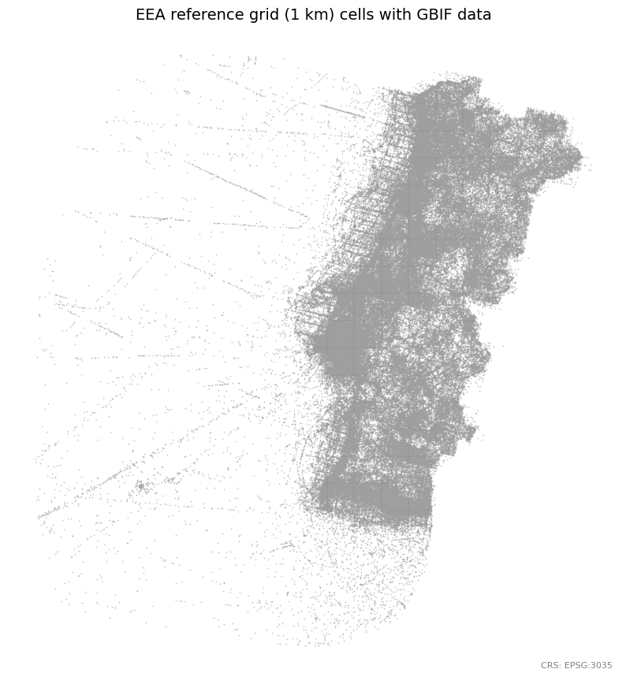
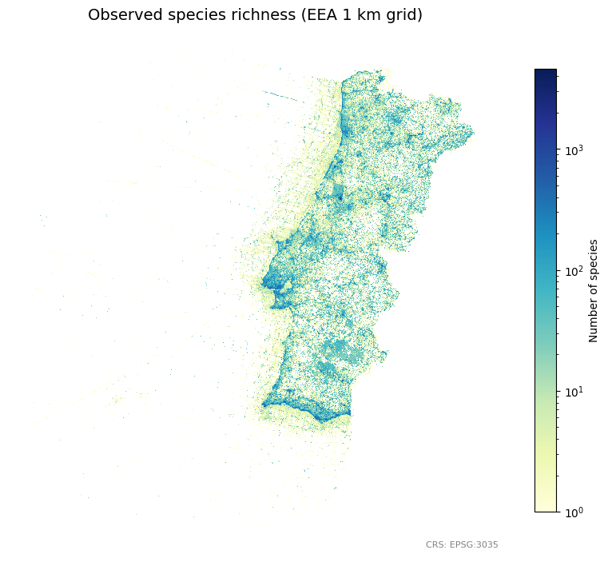
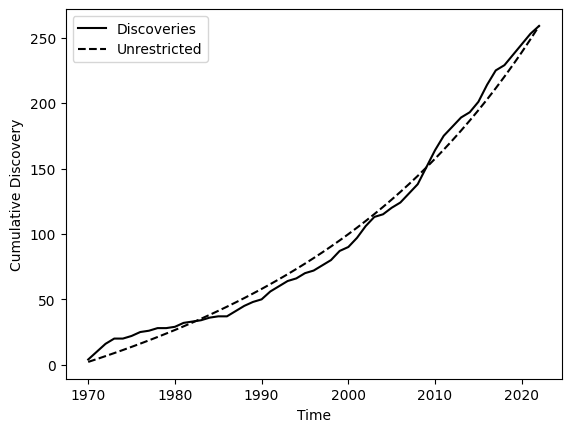
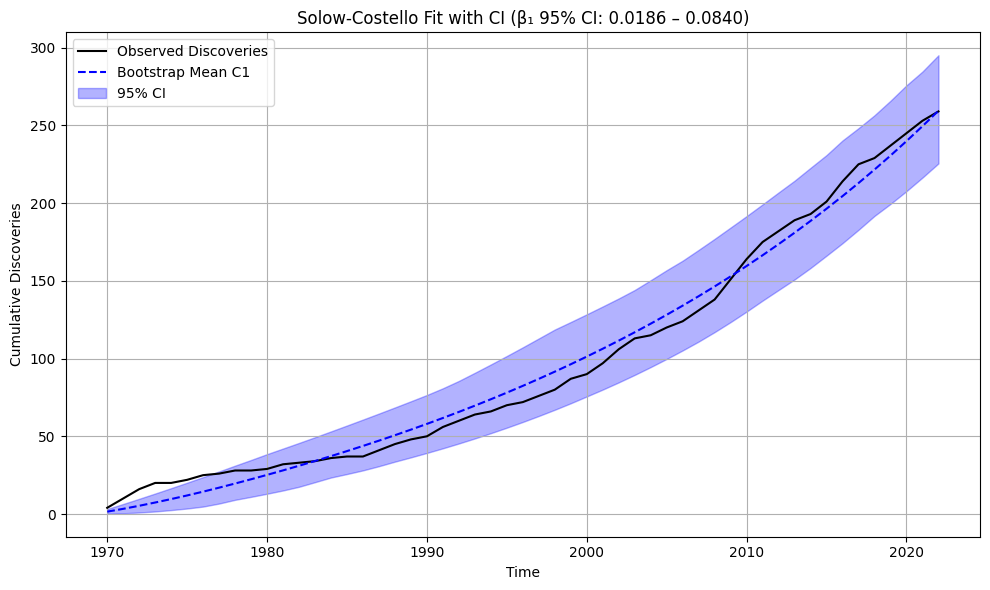
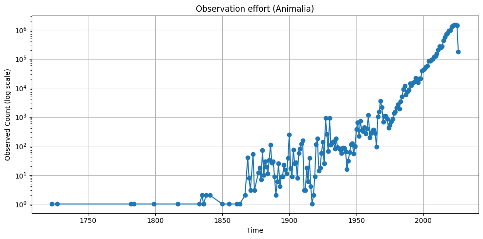
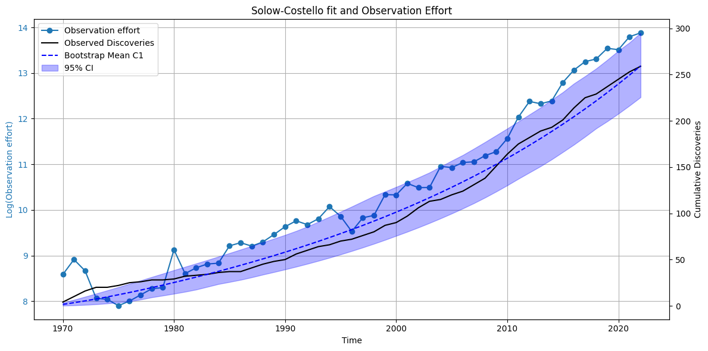
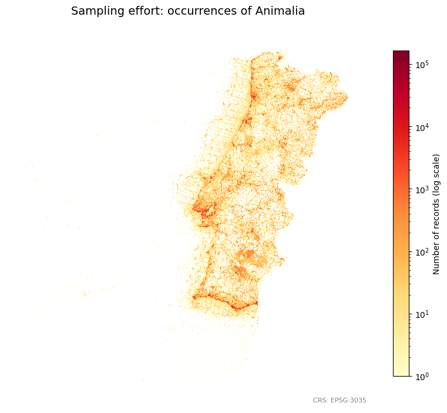
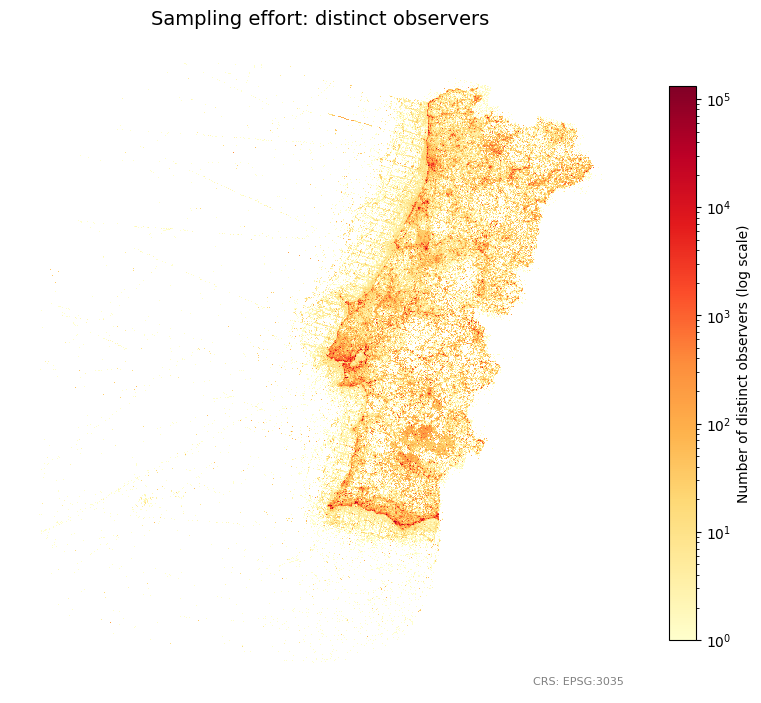

Exemplar workflow to determine the Rate of Establishment
========================================================

This Jupyter notebook will guide the user of the b3alien Python package to
generate a measure of the rate of establishment of alien species in a specific
region or country. This workflow can be modified to match the needs of the
user.

The example uses mainland Portugal, with two data sources that are expected in
the ``tests/data`` directory (they are not included in the GitHub repository
because of their size):

- ``PT_cube_mainland_new.zip``: a GBIF occurrence cube on the **EEA reference
  grid (1 km)**, generated on the new GBIF taxonomic backbone (Catalogue of
  Life eXtended Release), see Appendix A;
- ``GRIIS_PT_ColDP_extended.zip``: the GRIIS checklist of Portugal in **ColDP**
  format, downloaded from ChecklistBank (dataset
  `28948 <https://www.checklistbank.org/dataset/28948>`__).

Install the b3alien Python package
----------------------------------

.. code:: python

   %pip install -e ../../.

Load the software package and additional libraries
--------------------------------------------------

.. code:: python

   from b3alien import b3cube
   from b3alien import simulation
   from b3alien import griis
   from b3alien import utils

   import numpy as np
   import pandas as pd
   import geopandas as gpd
   import matplotlib.pyplot as plt

   %matplotlib inline

Step 1: Generate a Biodiversity Data Cube from GBIF
---------------------------------------------------

The workflow assumes as an input an occurrence cube generated on the GBIF
infrastructure, using the SQL API interface to GBIF data. How to generate this
cube is described in Appendix A.

As a result of the cube generation through GBIF, you can download a CSV file
(zipped), which only contains the cell code of the chosen geographic grid. For
cubes on the **EEA reference grid** (column ``eeacellcode``,
e.g. ``1kmE2639N1762``), the b3alien package computes the geometry of the grid
cells directly from the cell codes (in EPSG:3035, ETRS89 / LAEA Europe). No
GeoParquet file or GeoPackage is needed, and the zip file can be loaded as is.

Cubes generated on the new GBIF taxonomic backbone use alphanumeric keys
(e.g. ``CPZZL`` for *Ardea ibis*), instead of the numeric keys of the previous
backbone. The package handles both.

Optional: create a GeoParquet file
~~~~~~~~~~~~~~~~~~~~~~~~~~~~~~~~~~

For other grids (e.g. the Extended Quarter Degree Grid Cells), the geometry
needs to be matched with a GeoPackage of the grid
(https://download.gbif.org/grids/EQDGC/ or on Zenodo):

.. code:: python

   utils.to_geoparquet(csvFile, geoFile, leftID='eqdgccellcode', rightID='cellcode',
                       exportPath='./data/export.parquet')

For EEA grid cubes you can also store the cube as a GeoParquet file without any
GeoPackage, which is faster to load in subsequent sessions:

.. code:: python

   utils.to_geoparquet(csvFile, leftID='eeacellcode', exportPath='./data/export.parquet')

Step 2: Download the GRIIS checklist of the considered country, and load it as a checklist object
-------------------------------------------------------------------------------------------------

Download the GRIIS checklist of your country from
`ChecklistBank <https://www.checklistbank.org>`__ in ColDP format. In this
exemplar workflow we use the checklist of Portugal.

The ColDP package only contains the identifiers of the checklist itself. To
compare the checklist with the occurrence cube, the scientific names are
matched to the **same taxonomic backbone** as the cube (the Catalogue of Life
eXtended Release, which is the default). Synonyms are resolved to their
accepted species and infraspecific taxa to their species, since the cube is
aggregated at species level:

.. code:: python

   coldp_file = "../data/GRIIS_PT_ColDP_extended.zip"
   checklist_dir = "../data/GRIIS_PT_ColDP_extended/"

   merged = griis.do_taxon_matching(coldp_file, output_dir=checklist_dir)

::

   Matching names: 100%|██████████| 1026/1026 [00:04<00:00, 222.61it/s]

::

   Matched 1013/1026 distribution records. Output written to ../data/GRIIS_PT_ColDP_extended

This function is calling the GBIF API. Be gentle with it, and don’t use it too
much in a short time frame.

The names that could not be matched at species level are flagged as ‘Uncertain’
and are left out of the analysis. It is good practice to check them, since they
often point to spelling errors or data issues in the checklist:

.. code:: python

   merged.loc[merged["speciesKey"] == "['Uncertain']", ["id", "scientificName", "authorship", "rank", "kingdom"]]

::

           id                  scientificName          authorship     rank  \
   23   37557            Cyperus involucratus                 NaN  species
   178  38218     Symphocladia marchantioides                 NaN  species
   209  37940                Ostreopsis ovata              Fukuyo  species
   261  37505                  Conyza rouyana              Sennen  species
   359     ~Q              Carya illinoiensis   (Wangenh.) K.Koch  species
   367  37980               Pelophylax perezi                 NaN  species
   424  38212               Strandesia vavrai  (G.W.Muller, 1898)  species
   459  38166                  Silene armeria                 NaN  species
   477  37611                 Erigeron mixtus          Arv.-Touv.  species
   739  37777             Kyllinga brevifolia                 NaN  species
   776  37614              Erigeron × rouyana                 NaN  species
   809  37724  Hebe sp. Ã-andersonii Cockayne                 NaN  species
   892  37892  Mycale (Carmia) sp. Gray, 1867                 NaN  species
          kingdom
   23     Plantae
   178   Animalia
   209  Chromista
   261    Plantae
   359    Plantae
   367    Plantae
   424   Animalia
   459    Plantae
   477    Plantae
   739    Plantae
   776    Plantae
   809    Plantae
   892   Animalia

Two files are generated in the output directory: ``merged_distr.txt`` (the
distribution records with the matched keys) and ``speciesprofile.txt``
(invasiveness and habitat, derived from the ColDP ``TaxonProperty`` table).
Both can be loaded as a CheckList object:

.. code:: python

   CL = griis.CheckList(checklist_dir)
   len(CL.species)

::

   998

The checklist can be filtered on the species profile, e.g. to only keep the
invasive species, or the species of a specific habitat (Terrestrial,
Freshwater, Marine, …):

.. code:: python

   CL_marine_invasive = griis.CheckList(checklist_dir, use_profile=True, invasive_val="Invasive", habitat_val="Marine")
   len(CL_marine_invasive.species)

::

   8

Step 3: Load the OccurrenceCube
-------------------------------

The GBIF download (zip or CSV) can be loaded directly with ``source='gbif'``.
The grid is detected automatically, and for the EEA grid the cell geometries
are added:

.. code:: python

   cube = b3cube.OccurrenceCube("../data/PT_cube_mainland_new.zip", source="gbif")

   print(f"Grid: {cube.grid_type} (column '{cube.grid_column}'), CRS: {cube.crs}")
   print(f"Records: {len(cube.df):,}")
   print(f"Cube dimensions (time, cell, species): {cube.data.shape}")

::

   Grid: eea (column 'eeacellcode'), CRS: EPSG:3035
   Records: 8,527,611
   Cube dimensions (time, cell, species): (1942, 97541, 28937)

A GeoParquet file, stored locally or on Google Cloud, can be loaded with the
same class. For example:

.. code:: python

   cube = b3cube.OccurrenceCube("gs://b-cubed-eu/data_BE.parquet", gproject='$YOUR_GPROJECT')

Support for other cloud providers might be implemented in a next version of the
software.

.. code:: python

   cube.df.head()

::

       kingdom kingdomkey    phylum phylumkey class classkey           order  \
   0  Animalia          N  Chordata       CH2  Aves       V2  Pelecaniformes
   1  Animalia          N  Chordata       CH2  Aves       V2  Pelecaniformes
   2  Animalia          N  Chordata       CH2  Aves       V2  Pelecaniformes
   3  Animalia          N  Chordata       CH2  Aves       V2  Pelecaniformes
   4  Animalia          N  Chordata       CH2  Aves       V2  Pelecaniformes
     orderkey    family familykey  ...       cellcode kingdomcount phylumcount  \
   0      3RZ  Ardeidae       6PB  ...  1kmE2639N1762          126         126
   1      3RZ  Ardeidae       6PB  ...  1kmE2639N1762         1283        1283
   2      3RZ  Ardeidae       6PB  ...  1kmE2641N1757           52          52
   3      3RZ  Ardeidae       6PB  ...  1kmE2650N1946            4           4
   4      3RZ  Ardeidae       6PB  ...  1kmE2656N1771           66          66
     classcount ordercount familycount  genuscount  distinctobservers  \
   0        126          2           2           2                  2
   1       1283          4           4           3                  3
   2         52          4           4           1                  1
   3          4          1           1           1                  1
   4         66          1           1           1                  1
      occurrences                                           geometry
   0            2  POLYGON ((2640000 1762000, 2640000 1763000, 26...
   1            3  POLYGON ((2640000 1762000, 2640000 1763000, 26...
   2            1  POLYGON ((2642000 1757000, 2642000 1758000, 26...
   3            1  POLYGON ((2651000 1946000, 2651000 1947000, 26...
   4            1  POLYGON ((2657000 1771000, 2657000 1772000, 26...
   [5 rows x 25 columns]

Visualisation of the grid
~~~~~~~~~~~~~~~~~~~~~~~~~

The grid cells of the cube can be plotted with ``plot_grid``. Without a value,
only the grid cells for which data is available are drawn:

.. code:: python

   fig, ax = b3cube.plot_grid(cube, title="EEA reference grid (1 km) cells with GBIF data")

|image1|

Additionally, it is possible to add the “Observed Species Richness” as a
property of the data cube, and plot it on the grid. This is not needed for the
remainder of the workflow. Since the species richness is highly skewed, a
logarithmic colour scale is used:

.. code:: python

   cube._species_richness()
   cube.richness.describe()

::

              richness
   count  97541.000000
   mean      28.019653
   std       60.363200
   min        1.000000
   25%        2.000000
   50%        7.000000
   75%       31.000000
   max     4634.000000

.. code:: python

   fig, ax = b3cube.plot_grid(cube, column="richness", log=True,
                              title="Observed species richness (EEA 1 km grid)",
                              legend_label="Number of species")

|image2|

The same function can create an interactive map (Folium) with
``kind="interactive"``. For fine grids with many cells (here almost 100,000),
the resulting map is large, so it is best saved as an HTML file outside of the
notebook:

.. code:: python

   m = b3cube.plot_grid(cube, column="richness", kind="interactive")
   m.save("richness_map.html")

Use ``b3cube.grid_geodataframe(cube, column="richness")`` to obtain a
GeoDataFrame with one row per grid cell for further analysis, or
``output_path=`` in ``plot_grid`` to save a publication-ready figure.

Step 4: Calculate the Rate of Establishment from the CheckList and OccurrenceCube
---------------------------------------------------------------------------------

After generating the basic objects, we can calculate the cumulative number of
introduced species, and determine the rate of introduction by the
Solow-Costello algorithm.

.. code:: python

   d_s, d_c = b3cube.cumulative_species(cube, CL.species)

.. code:: python

   d_s.head()

::

         time           cell species  occurrences  seen
   0  1853-03  1kmE2728N1736   3WF58          1.0     1
   1  1853-03  1kmE2728N1736   5BFGF          1.0     1
   2  1853-03  1kmE2728N1737   3DX7D          3.0     1
   3  1853-03  1kmE2728N1737   3WF58          2.0     1
   4  1853-03  1kmE2728N1737   5BFGF          1.0     1

This function is returning two dataframes, a sparse dataframe (d_s) which
contains the occurrences of the checklist species per cell and month, and a
dataframe (d_c) with the cumulative number of species over time, which is cell
independent. It is this last dataframe that we will use in the rest of the
calculation. The first dataframe might be useful to have some spatial insight
in the number of species.

.. code:: python

   print(f"Checklist species observed in the cube: {d_s['species'].nunique()} of {len(CL.species)}")
   d_c.tail()

::

   Checklist species observed in the cube: 802 of 998

::

              time  cumulative_species
   1364 2026-07-01                 800
   1365 2026-08-01                 802
   1366 2026-09-01                 802
   1367 2026-10-01                 802
   1368 2026-11-01                 802

From there, we can calculate the rate:

.. code:: python

   time, rate = b3cube.calculate_rate(d_c)

For applying the strategy defined by the GBF, it is useful to calculate the
rate of introduction for different time windows. Therefore, a filtering
function was developed to determine for which time interval the calculation
needs to be done. In the rest of this exemplar notebook, we use the time frame
1970 - 2022.

.. code:: python

   df = pd.DataFrame({
       "year": time,
       "rate": rate
   })

   time, rate = b3cube.filter_time_window(df, 1970, 2022)

With the filtered time and rate, we can simulate the rate of introduction:

.. code:: python

   C1, vec1 = simulation.simulate_solow_costello_scipy(time, rate, vis=True)

|image3|

The vector ‘vec1’ contains the parameters of the fitting of the Solow-Costello
model. The most important parameter in this case is the rate of establishment
(2nd parameter).

.. code:: python

   print("Fitted Rate of Establishment from the data cube: " + str(vec1[1]) + "/year")

::

   Fitted Rate of Establishment from the data cube: 0.04084119821751564/year

Step 5: Determine the error margins on the fitted rate of establishment
-----------------------------------------------------------------------

The software package also includes the determination of the 95% confidence
interval. This step is most efficiently run on a multi core machine, since it
is using parallel computing. The method is using bootstrapping on the
residuals.

.. code:: python

   results = simulation.parallel_bootstrap_solow_costello(time, rate, n_iterations=200)

   simulation.plot_with_confidence(time, rate, results)

::

   Bootstrapping: 100%|██████████| 200/200 [00:47<00:00,  4.17it/s]

|image4|

The bootstrap results can also be summarised per year, including the
uncertainty on the annual rate of establishment:

.. code:: python

   rates_results = simulation.run_bootstrap_analysis(time, rate, n_iterations=200)
   print(rates_results.tail().to_string())

::

   Starting 200 bootstrap iterations...
   ==============================
   FITTING PARAMETERS RESULTS
   ==============================
   Parameter vec1[1]: 0.037306 ± 0.018985
   ==============================
       Year  Annual_Rate  Annual_Rate_Error  Cumulative_Value  Cumulative_Error  Lower_CI_95  Upper_CI_95
   48  2018     8.657209           0.741456        221.069188         16.890429     7.203956    10.110463
   49  2019     8.952469           0.814518        230.021657         16.979711     7.356014    10.548925
   50  2020     9.254436           0.905131        239.276093         17.064672     7.480380    11.028492
   51  2021     9.565808           1.032350        248.841901         17.154802     7.542401    11.589214
   52  2022     9.878999           1.169767        258.720900         17.260986     7.586255    12.171742

Step 6: Determine the survey effort
-----------------------------------

In the reporting procedure for the GBF Target 6 indicator, there is a
requirement of plotting the survey effort next to the cumulative discovery of
species to have an idea on the detectability. In this section we give 2
examples of how you can approach this using the pure GBIF occurrence cube.

Aggregate the counts at a higher taxonomic level
~~~~~~~~~~~~~~~~~~~~~~~~~~~~~~~~~~~~~~~~~~~~~~~~

One possible strategy is to count the total number of occurrences at a higher
taxonomic level. In this example, we count the total number of occurrences of
the kingdom Animalia per cell and month:

.. code:: python

   gdf = b3cube.aggregate_count_per_cell(cube, "kingdom", "Animalia")

Aggregation in space:

.. code:: python

   aggregated_gdf_space = gdf.groupby("cellcode", observed=True).agg({
       "kingdomcount": "sum",
       "geometry": "first"  # the geometry is unique per cell
   }).reset_index()

   survey_eff_spatial = gpd.GeoDataFrame(aggregated_gdf_space, geometry="geometry", crs=gdf.crs)
   survey_eff_spatial.head()

::

           cellcode  kingdomcount  \
   0  1kmE2284N1783             2
   1  1kmE2316N1934            97
   2  1kmE2375N1962             1
   3  1kmE2399N1745             1
   4  1kmE2476N2183             3
                                               geometry
   0  POLYGON ((2285000 1783000, 2285000 1784000, 22...
   1  POLYGON ((2317000 1934000, 2317000 1935000, 23...
   2  POLYGON ((2376000 1962000, 2376000 1963000, 23...
   3  POLYGON ((2400000 1745000, 2400000 1746000, 23...
   4  POLYGON ((2477000 2183000, 2477000 2184000, 24...

Aggregation in time:

.. code:: python

   aggregated_gdf_time = gdf.groupby("yearmonth", observed=True).agg({
       "kingdomcount": "sum"
   }).reset_index()

   aggregated_gdf_time["year"] = aggregated_gdf_time["yearmonth"].astype(str).str[:4].astype(int)
   yearly_agg = aggregated_gdf_time.groupby("year")["kingdomcount"].sum().reset_index()

Afterwards you can plot the aggregated counts per year, to get an idea on the
survey effort over time:

.. code:: python

   plt.figure(figsize=(10, 5))
   plt.plot(yearly_agg["year"], yearly_agg["kingdomcount"], marker="o")
   plt.yscale("log")
   plt.title("Observation effort (Animalia)")
   plt.xlabel("Time")
   plt.ylabel("Observed Count (log scale)")
   plt.grid(True)
   plt.tight_layout()
   plt.show()

|image5|

Survey effort by determining the number of distinct observers
~~~~~~~~~~~~~~~~~~~~~~~~~~~~~~~~~~~~~~~~~~~~~~~~~~~~~~~~~~~~~

This is another potential measure of the survey effort. If you created the data
cube according to Appendix A, this measure is readily available.

.. code:: python

   survey_eff = b3cube.get_survey_effort(cube, calc_type='distinct')

   survey_eff["year"] = survey_eff["date"].dt.year
   time2, observ = b3cube.filter_time_window(survey_eff, 1970, 2022, cols=["year", "distinct_observers"])

Using the results from the simulation in previous steps, we can now plot the
survey effort and the cumulative distribution together on a single plot. For
clarity, we plot the logarithm of the survey effort, since there is a huge
amount of GBIF data that is coming from citizen science programs. This results
in an enormous increase in available data.

.. code:: python

   fig, ax1 = plt.subplots(figsize=(12, 6))

   # Survey effort (left y-axis)
   color = 'tab:blue'
   ax1.set_xlabel('Time')
   ax1.set_ylabel('Log(Observation effort)', color=color)
   ax1.plot(time2, np.log(observ), marker='o', linestyle='-', color=color, label='Observation effort')
   ax1.tick_params(axis='y', labelcolor=color)
   ax1.grid(True)

   # Cumulative discoveries and Solow-Costello fit (right y-axis)
   ax2 = ax1.twinx()
   ax2.plot(time, np.cumsum(rate), 'k-', label='Observed Discoveries')
   ax2.plot(time, results["c1_mean"], 'b--', label='Bootstrap Mean C1')
   ax2.fill_between(time, results["c1_lower"], results["c1_upper"], color='blue', alpha=0.3, label='95% CI')
   ax2.set_ylabel('Cumulative Discoveries')

   plt.title('Solow-Costello fit and Observation Effort')

   lines1, labels1 = ax1.get_legend_handles_labels()
   lines2, labels2 = ax2.get_legend_handles_labels()
   ax2.legend(lines1 + lines2, labels1 + labels2, loc='upper left')

   fig.tight_layout()
   plt.show()

|image6|

Spatial distribution of the survey effort
~~~~~~~~~~~~~~~~~~~~~~~~~~~~~~~~~~~~~~~~~

To get an idea on the geographical distribution of the survey effort, we can
plot it on the grid. ``plot_grid`` accepts the GeoDataFrame with the aggregated
counts at kingdom level:

.. code:: python

   fig, ax = b3cube.plot_grid(survey_eff_spatial, column="kingdomcount", log=True, cmap="YlOrRd",
                              title="Sampling effort: occurrences of Animalia",
                              legend_label="Number of records (log scale)")

|image7|

For columns of the cube itself, such as the number of distinct observers,
``plot_grid`` aggregates the values per grid cell directly from the cube:

.. code:: python

   fig, ax = b3cube.plot_grid(cube, column="distinctobservers", log=True, cmap="YlOrRd",
                              title="Sampling effort: distinct observers",
                              legend_label="Number of distinct observers (log scale)")

|image8|

A basemap can be added with ``basemap=True`` (requires the optional
``contextily`` package), and the figure can be saved for publication with
``output_path="survey_effort.png"``.

